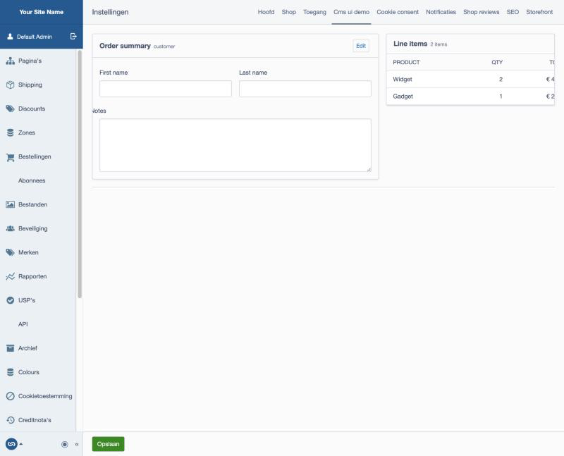

# SilverShop CMS UI

Neutral, structural **CMS UI primitives** for the Silverstripe 6 admin, built for the SilverShop suite
but **shop-agnostic** (no `silvershop/core` dependency, usable on any Silverstripe 6 project).

It ships:

- **[`GridLayoutField`](#gridlayoutfield)**: lays a `CompositeField`'s children out on the admin's
  Bootstrap 5 grid (responsive 12-column spans), with an opt-in **full-page-width** mode and an
  **fr-template escape hatch** for exact, non-12-column ratios.
- **[`PanelField`](#panelfield)**: a native-blend **card** (`.ss-panel`) with a head (optional icon, title,
  muted count and right-aligned **live** action fields) and a body that holds the real fields (flush,
  scrollable or flat variants). Its two parts are also usable on their own as `PanelHeaderField` and
  `PanelBodyField`.
- **[`GridFieldFilterForm`](#gridfieldfilterform)**: an always-visible filter bar for any `GridField`,
  replacing the collapsed search foldout, built on the stock filter engine.
- **[Status badges and row tints](#status-badges-and-row-tints)** for any `GridField`:
  `addStatusBadges()`, `colorRowsByStatus()`, `hideStatusFlags()`.
- **[Icons](#icons)**: the full [Lucide](https://lucide.dev) icon set as a webfont, exposed as
  `.ss-icon-{name}` classes.

So a `ModelAdmin` edit form can be laid out as a responsive grid of panels instead of flat tab sprawl.
The primitives are deliberately minimal and **blend with the stock admin** (including its dark mode);
opinionated skins layer on top in the consuming module.



## Requirements

- PHP `^8.3`
- `silverstripe/framework` `^6.0`
- `silverstripe/admin` `^3.0`

## Install

```bash
composer require silvershop-suite/cms-ui
```

The assets are injected into the CMS automatically (via `LeftAndMain.extra_requirements_css` /
`extra_requirements_javascript`): one stylesheet, the icon font, and one small script for the filter bar.
They are loaded CMS-wide but **inert by default**: every rule is gated behind an opt-in class (`.ss-grid` /
`.ss-panel*` / `.ss-filter-form*` / `.ss-badge*` / `.ss-icon-*`) and the script only acts on a
`GridFieldFilterForm`, so a form that doesn't use the primitives is untouched.

## `GridLayoutField`

```php
use SilverShop\CmsUi\Forms\GridLayoutField;
use SilverStripe\Forms\TextField;

$grid = GridLayoutField::create('Address', [
    TextField::create('Street', 'Street'),
    TextField::create('Number', 'Nr'),
])->setColumns(['Street' => 8, 'Number' => 4]);   // 12-col spans
```

Spans may be a bare int (span at the default breakpoint, `md`) or a per-breakpoint array:

```php
GridLayoutField::create('Row')
    ->addColumn(TextField::create('First'), 6)                 // col-md-6
    ->addColumn(TextField::create('Last'),  ['md' => 6, 'lg' => 4]);
```

### Full page width

By default a grid keeps the admin's readable field width (~58%). `enableFullWidth()` breaks it out to
the **whole form row** — the headline feature for wide, column-heavy layouts:

```php
GridLayoutField::create('Wide', [...])->enableFullWidth();
```

Under the hood this is pure CSS: the admin caps every field's control wrapper
(`.form__field-holder { max-width: 895px }`, ~58% of the row). `enableFullWidth()` adds `.ss-grid-full`,
whose single rule reclaims the width:

```css
.CompositeField.ss-grid.ss-grid-full > .form__field-holder {
    width: 100% !important;
    max-width: none !important;
    flex: 1 1 100% !important;
}
```

No `LeftAndMain` rebuild and no custom admin JavaScript is involved — just CSS on opt-in class hooks.

### Exact ratios — the `setGridTemplate()` escape hatch

The 12-column model can't hit every ratio (e.g. a 1.7 : 1 split). `setGridTemplate()` takes an arbitrary
CSS `grid-template-columns` value and uses it verbatim, bypassing the 12-column math:

```php
GridLayoutField::create('Split', [$main, $aside])->setGridTemplate('1.7fr 1fr');
```

The value is carried as a scoped `<style>` rule injected through a hidden `LiteralField` child, so it
travels with the field's own markup and targets its inner `.form__field-holder` wrapper directly — no
per-instance inline attribute needed. A per-instance class scopes the rule to this grid alone, and the
value is sanitised before emission. Pass `null` to clear it and return to the 12-column model. Classes
don't inherit, so a **nested** `GridLayoutField`
keeps the default 12-column tracks.

### Other knobs

| Method | What it does |
| --- | --- |
| `setGutter('ss-gutter-0\|sm\|md\|lg')` | Column gap. Presets map to `--ss-gutter` (0 / 0.5em / 1.25em / 2em). A Bootstrap `g-*` class also works. |
| `setBreakpoint('xs')` | The breakpoint used for bare-int spans (default `md`). `xs` = always-on columns. |
| `setColumnCount(n)` | Inherited from `CompositeField`; cms-ui revives the admin's dropped `.multicolumn` CSS so `n` equal columns render again. |

On phones (`≤ 767.98px`) every grid collapses to a single stacked column that reads like a normal list
of fields.

## `PanelField`

```php
use SilverShop\CmsUi\Forms\PanelField;

PanelField::create('Summary', 'Order summary', [
    $someField,
    $anotherField,
])
    ->setCount('12 items')                                   // muted count after the title
    ->setActions('<a class="btn btn-secondary">Edit</a>')    // right-aligned header slot
    ->setFlush();                                            // body = edge-to-edge (tables, timelines)
```

| Method | What it does |
| --- | --- |
| `setTitle($title)` / constructor title | The head heading. |
| `setIcon($name)` | An icon before the title: an `ss-icon` glyph name without the prefix, e.g. `'truck'` (see [Icons](#icons)). |
| `setCount($text)` | A muted count/subtitle next to the title. |
| `setActions($html)` | Static, raw-HTML content for the right-aligned actions area (status pills, links). |
| `addAction($field)` | A **live** action in the head: a real child `FormField` (button, routed `GridField`, `HasOneButtonField`), so it is collated into the form and works. Several may be added; they share one right-aligned row with the same look on every panel. |
| `setActionsField($field)` | Replace the live head actions with a single field (`null` clears). |
| `setFlush($bool = true)` | Body becomes edge-to-edge (`.ss-panel__body--flush`), for a `GridField` / table / timeline. |
| `setBodyMaxHeight($css)` | Cap the body height and scroll on overflow while the head stays put (any CSS length, e.g. `'20em'`). |
| `setFlat($bool = true)` | Drop the card elevation (`.ss-panel--flat`). A panel nested in another panel's body is flattened automatically. |
| `setHeadingLevel($n)` | Heading level for the title (2–6, default 2). |
| `getHeader()` / `getBody()` | The head (`PanelHeaderField`) and body (`PanelBodyField`) composites, for direct use. |

Fields passed to the constructor (or via `push()`) go into the **body**; they render and save exactly
as normal schema fields.

### Composition

The intended shape is a full-width grid of panels:

```php
GridLayoutField::create('Layout', [
    PanelField::create('Main', 'Order', [ /* real fields, or a nested GridLayoutField */ ]),
    PanelField::create('Side', 'Customer', [ /* … */ ]),
])
    ->enableFullWidth()
    ->setGridTemplate('1.7fr 1fr');   // or ->setColumns([...]) for a 12-col ratio
```

## `GridFieldFilterForm`

An always-visible, multi-field filter bar that replaces Silverstripe 6's collapsed search foldout
(`GridFieldFilterHeader`). It extends that native header and only changes how it renders, so search,
sort, pagination and `GridState` persistence are the framework's own:

```php
use SilverShop\CmsUi\Forms\GridFieldFilterForm;
use SilverStripe\Forms\GridField\GridFieldDataColumns;
use SilverStripe\Forms\GridField\GridFieldFilterHeader;

$config->removeComponentsByType(GridFieldFilterHeader::class);
$config->addComponent(GridFieldFilterForm::create(), GridFieldDataColumns::class);
```

The fields come from the model's `searchable_fields`. All tuning is optional:

| Method | What it does |
| --- | --- |
| `setColumns($n)` | Equal `n`-column field grid (default: auto, 1–4 by field count). |
| `setColumnSpans(['Email' => 6, 'Status' => 3])` | Per-field 12-column spans instead of equal columns. |
| `setRestrictFields(['Reference', 'Name'])` | Show only these searchable fields. |
| `setFields($fieldList)` | Render your own field list instead of the scaffolded one. |
| `setTitle('Filter')` | A label above the fields (default: none). |
| `setActionsSpan($span)` | Put Search / Reset inline as the last grid cell of this span, instead of a separate row. |

Enter in a text field submits the filter (instead of saving the surrounding record), and changing a
select, checkbox or date submits instantly. That is the module's only JavaScript, and it reuses the
stock submit path.

## Status badges and row tints

Added to every `GridField`, but inert until you call a method:

```php
// Render a column's values as badge pills
$grid->addStatusBadges('Status', ['Paid' => 'success', 'Unpaid' => 'warning', 'Cancelled' => 'danger']);

// Tint whole rows by a status value
$grid->colorRowsByStatus('Status', ['Unpaid' => 'warning', 'Cancelled' => 'danger']);

// Hide the framework's own title-column status flag (avoids a double badge)
$grid->hideStatusFlags();
```

Built-in tokens: `success`, `warning`, `danger`, `info`, `neutral` (the fallback). A map value can also
be a raw `#hex` (badges only), or your own token name styled with `.ss-badge--{token}` /
`.ss-grid-row--{token}`. To key the colour off a different field than the one displayed (for example a
translated label column), pass it as the third argument:
`addStatusBadges('StatusI18N', $map, 'Status')`. A project-wide default map can be set in YAML:

```yaml
SilverShop\CmsUi\Extensions\GridFieldStatusExtension:
  status_tokens:
    Paid: success
    Unpaid: warning
```

## Icons

The complete [Lucide](https://lucide.dev) set ships as one webfont (`client/fonts/ss-icons.woff2`,
about 290 KB, admin-only) with one class per glyph, prefixed `ss-icon-` so it never collides with core's
legacy icon font:

```html
<span class="ss-icon-truck" aria-hidden="true"></span>
```

Use the classes in `$menu_icon_class`, in templates or literal fields, or via `PanelField::setIcon('truck')`.

## Styling & theming

cms-ui ships **one small stylesheet** and styles **only its own classes** (`.ss-panel*`, `.ss-grid`,
the `.col-*` mapping) — never admin-internal selectors, and never the admin's own bare `.panel`
container. Tokens alias the admin's `--bs-*` custom properties, so the primitives blend with the native
admin and inherit its **dark mode** for free:

```css
:root {
    --ss-gutter: 1.25em;
    --ss-panel-bg: var(--bs-body-bg, #fff);
    --ss-panel-border: var(--bs-border-color, #ced5e1);
    --ss-panel-radius: var(--bs-border-radius, 0.23em);
    --ss-panel-shadow: var(--bs-box-shadow-sm, 0 1px 2px rgba(0, 0, 0, 0.08));
    --ss-panel-title-color: var(--bs-body-color, #43536d);
    --ss-panel-muted: var(--bs-secondary-color, #74809a);
    /* … */
}
```

A consumer skin overrides just these tokens (and/or styles its own component classes scoped to its
section) to apply an opinionated look. Units are `em` throughout — the admin's startup theme sets the
root font-size to 62.5% (10px), which makes `rem` render too small inside a module stylesheet.

Because every colour is aliased to a `--bs-*` token, the panels track the admin's theme automatically —
here with a dark `--bs-*` palette applied, the card surfaces, borders and text follow (the field inputs
are the admin's own surfaces):


## Accessibility

A panel's head renders a real heading (`<h2>`/`<h3>`), giving it a name in the CMS heading outline that
assistive tech can navigate to — the heading is the panel's accessible anchor.

## Scope

- **Small by design**: one stylesheet, the icon font, one delegated script (the filter bar's Enter /
  instant submit), no `.ss` templates and no `LeftAndMain` extension.
- **Deferred:** collapsible panels (`PanelField->setCollapsible()`).

## Translations

Ships with English, Dutch, German, Spanish, French and Italian (`lang/*.yml`).

## License

BSD-3-Clause. Copyright (c) 2026 Remy Vaartjes. See [LICENSE](LICENSE).

The bundled Lucide icon font is © Lucide Icons and Contributors, under the ISC license
([licenses/lucide-LICENSE](licenses/lucide-LICENSE)).

## Credits

Developed by [Remy Vaartjes](https://github.com/RVXD) and the SilverShop-Suite Contributors.
